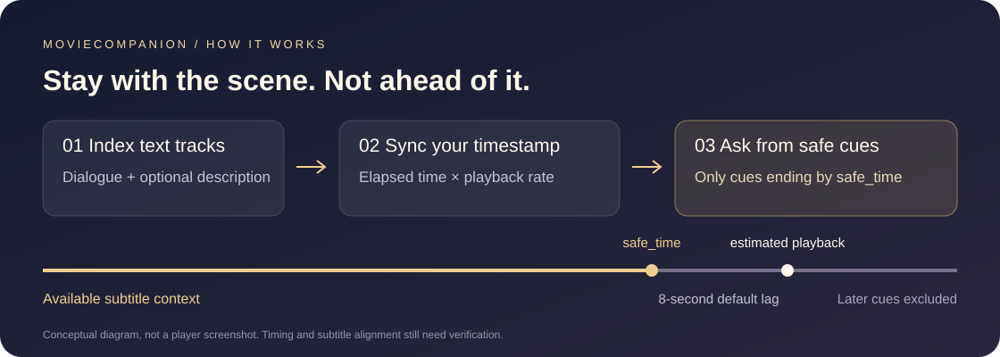

<div align="center">


# 电影搭子.skill · MovieCompanion

<a id="english"></a>
**Talk about the story you have just watched, without rushing into the next scene.**

A subtitle-grounded movie companion that follows your playback position.

**English** · [简体中文](README.md)

[](skills/movie-companion/SKILL.md)
[](skills/movie-companion/scripts/movie_sync.py)
[](LICENSE)

[Quick start](#快速开始) · [Reproducible example](#试跑字幕边界) · [Boundaries and privacy](#边界与隐私) · [Development and docs](#开发与文档)

</div>



<a id="它解决什么"></a>
## What it helps with

Forgot a character relationship, missed a line, or just want to talk about a difficult scene? MovieCompanion gives Codex the **current playback position** and **subtitle evidence**, keeping discussion within what you have already watched. Its tone is informal and inclusive, and screenshots are not required.

| You provide | The script handles | The Skill handles |
| --- | --- | --- |
| Lawfully obtained `.srt` / `.vtt` subtitles | An index with cue start and end times | Explaining dialogue, characters, and scenes from available subtitles |
| The visible timestamp when starting or resuming | Progress estimates from wall-clock time and playback rate | Fetching fresh context before each answer |
| Optional descriptive subtitles, SDH, or audio-description text | Combining dialogue and descriptive tracks | Admitting when visual evidence is missing |

**This is a Codex Skill with a Python helper, not a player plugin.** It does not read the player's internal position or control video. By default, answers use context ending 8 seconds before estimated progress to reduce early subtitle disclosure. This is not an absolute no-spoiler guarantee.

<a id="快速开始"></a>
## Quick start

You need Codex with local Skills support and Python 3. The helper uses only the Python standard library.

<a id="1-安装"></a>
### 1. Install

Use the Skill installer in Codex:

```text
$skill-installer install the movie-companion skill from yuzhang-zhong/MovieCompanion.skill with path skills/movie-companion
```

Restart Codex, then invoke `$movie-companion`.

<details>
<summary>Manual installation or Skills CLI</summary>

```bash
git clone https://github.com/yuzhang-zhong/MovieCompanion.skill.git movie-companion
cd movie-companion
bash scripts/install.sh
```

On Windows PowerShell, run `powershell -File .\scripts\install.ps1` from the repository root. The default destination is `~/.codex/skills/movie-companion`; the Bash script also accepts a target directory as its first argument.

Skills CLI:

```bash
npx skills add yuzhang-zhong/MovieCompanion.skill --agent codex
```

If a selection menu appears, choose `movie-companion`. Restart Codex after installation.

</details>

<a id="2-给出字幕和起点"></a>
### 2. Supply subtitles and a starting point

```text
Use $movie-companion. I have the film's dialogue subtitles at /path/to/movie.srt.
开始观看 00:17:42. Please discuss only what I have already watched.
```

The example retains the original Chinese synchronization phrase. You can then ask what a recent line means or how the characters relate at this point.

<a id="3-播放状态变了就重新同步"></a>
### 3. Resynchronize when playback changes

The original control phrases are retained below, with English explanations:

| Playback action | Tell the companion |
| --- | --- |
| Pause | `暂停` |
| Resume, seek, replay, or change speed | `开始观看 00:28:10`, with the new playback rate |
| End the session | `关闭放映模式` |

Buffering, a mismatched subtitle edition, or an unreported pause can cause drift. Use the actual player timestamp and resynchronize whenever uncertain.

<a id="试跑字幕边界"></a>
## Try the subtitle boundary

The repository includes [three fictional dialogue cues](skills/movie-companion/examples/sample-dialogue.srt). No movie file, API key, or third-party package is needed. Run from the repository root:

```bash
python skills/movie-companion/scripts/movie_sync.py index \
  --subtitle skills/movie-companion/examples/sample-dialogue.srt \
  --movie "Sample dialogue" --output .movie-companion/sample-index.json

python skills/movie-companion/scripts/movie_sync.py start \
  --index .movie-companion/sample-index.json --at 00:00:20 \
  --rate 0 --session .movie-companion/sample-session.json

python skills/movie-companion/scripts/movie_sync.py ask \
  --session .movie-companion/sample-session.json --before 900
```

`--rate 0` freezes this example at 20 seconds; normal playback uses the default rate `1`. The relevant output is:

```json
{
  "estimated_time": "00:00:20.000",
  "safe_time": "00:00:12.000",
  "future_window_seconds": 0.0,
  "cues": [
    {"start": 1.0, "end": 3.0, "text": "The door is locked.", "track": "dialogue"},
    {"start": 8.0, "end": 10.0, "text": "I heard something upstairs.", "track": "dialogue"}
  ]
}
```

This is an excerpt of actual script output. The third cue at 30–32 seconds is excluded. Use `ask` for normal accompaniment; the lower-level `context --after` option is for debugging and should not enable a future window during viewing.

<a id="边界与隐私"></a>
## Boundaries and privacy

- It is not a video-understanding system. It does not directly read DRM-protected Netflix, Disney+, or similar video. Ordinary dialogue subtitles cannot describe every action or visual detail.
- It cannot promise zero spoilers. Filtering is deterministic, but timing drift, incorrect subtitles, and model noncompliance remain risks. The Skill requires using returned safe context, not a model's knowledge of the ending.
- Use only content you may lawfully access. It does not assist in acquiring pirated movies. More complete descriptive tracks can support more scene explanations.
- Local files are not traceless. The helper writes subtitle indexes, source paths, and viewing sessions to local JSON. Context sent to Codex remains subject to your client's processing practices.

<a id="开发与文档"></a>
## Development and documentation

```bash
python -m unittest discover -s tests
```

- [Skill behavior contract](skills/movie-companion/SKILL.md): synchronization, conversational tone, and subtitle sources
- [Architecture and state machine](skills/movie-companion/references/architecture.md): indexes, sessions, and time boundaries
- [Chinese design notes](搭子说明.md)
- [Core CLI](skills/movie-companion/scripts/movie_sync.py): `index` / `start` / `where` / `context` / `ask` / `pause` / `close` / `status`

<a id="许可证--license"></a>
## License

MIT License, Copyright (c) 2026 Vincent Zhong. See [LICENSE](LICENSE).
