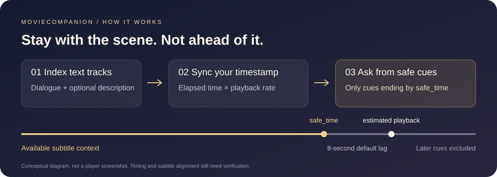

<div align="center">


# 电影搭子.skill · MovieCompanion

**简体中文** · [English (full README)](README.en.md)

**陪你聊刚刚看见的故事，不抢先讲下一幕。**

边看电影边聊剧情、严格根据 SRT / VTT 字幕播放时间轴防剧透（无剧透）的 AI 陪看电影搭子 Agent Skill 与 Python 同步脚本。<br>
A spoiler-free (no-spoiler) live movie watch-along Agent Skill and Python SRT/VTT subtitle sync script that tracks your current playback timestamp and discusses dialogue, characters, and plot strictly up to the scene you have watched.

[](skills/movie-companion/SKILL.md)
[](skills/movie-companion/scripts/movie_sync.py)
[](LICENSE)

[快速开始](#快速开始) · [可复现示例](#试跑字幕边界) · [边界与隐私](#边界与隐私) · [开发与文档](#开发与文档) · [English](#english)

</div>

> **一句话速览 / Quick answer：** 看电影脸盲认不清人物、没听懂台词，想边看边问 AI 又怕剧透？`movie-companion`（电影搭子）能跟着你当前的电影播放进度读取字幕（SRT / VTT），只聊你已经看到的情节，严格不剧透（防剧透 / 无剧透）后面没演到的剧情。 / Confused about who a character is or what a line meant while watching a movie? `movie-companion` is an AI watch-along buddy Skill and Python helper that tracks your current movie timestamp from subtitles and explains scenes without spoiling upcoming plot twists.



## 它解决什么

看到一半忘了人物关系、没听懂一句对白，或者只是想说一句“这一幕好难受”？电影搭子把**当前播放位置**和**字幕证据**交给 Codex，让讨论停留在你已经看到的范围内，语气轻松、包容，不要求你提供截图。

| 你提供 | 脚本负责 | Skill 负责 |
| --- | --- | --- |
| 合法取得的 `.srt` / `.vtt` 字幕 | 解析为带起止时间的字幕索引 | 根据可用字幕解释对白、人物和场景 |
| 开始 / 继续时屏幕上的时间点 | 用墙钟时间与播放速率估算进度 | 每次回答前重新获取上下文 |
| 可选描述字幕、SDH 或音频描述文本 | 合并对白与描述轨 | 没有视觉证据就明确说不知道 |

**这是 Codex Skill + Python 辅助脚本，不是播放器插件。** 它不读取播放器内部进度，也不控制视频。默认将回答范围设在估算进度之前 8 秒，以降低字幕提前泄露的风险；这不是绝对无剧透保证。

## 快速开始

需要可使用本地 Skills 的 Codex，以及 Python 3。辅助脚本仅使用 Python 标准库。

### 1. 安装

在 Codex 中使用 Skill 安装器：

```text
$skill-installer install the movie-companion skill from yuzhang-zhong/MovieCompanion.skill with path skills/movie-companion
```

安装后重启 Codex，使用 `$movie-companion` 调用。

<details>
<summary>也可以手动安装，或使用 Skills CLI</summary>

```bash
git clone https://github.com/yuzhang-zhong/MovieCompanion.skill.git movie-companion
cd movie-companion
bash scripts/install.sh
```

Windows PowerShell：在仓库根目录运行 `powershell -File .\scripts\install.ps1`。脚本默认将 Skill 安装到 `~/.codex/skills/movie-companion`；Bash 脚本也接受目标目录作为第一个参数。

开放 Skills CLI 入口：

```bash
npx skills add yuzhang-zhong/MovieCompanion.skill --agent codex
```

如出现选择菜单，选择 `movie-companion`。安装完成后重启 Codex。
</details>

### 2. 给出字幕和起点

```text
使用 $movie-companion。我有这部电影的对白字幕 /path/to/movie.srt。
开始观看 00:17:42。请只聊我已经看到的内容。
```

之后可以问：“刚才那句是什么意思？”“到这里为止，他们是什么关系？”

### 3. 播放状态变了，就重新同步

| 实际操作 | 告诉搭子 |
| --- | --- |
| 暂停影片 | `暂停` |
| 继续、跳转、回看或调整倍速 | `开始观看 00:28:10`，并说明新的倍速 |
| 结束本次观看 | `关闭放映模式` |

网络缓冲、字幕版本差异和忘记报暂停都会造成偏差。以播放器实际显示时间为准，不确定时重新同步。

## 试跑字幕边界

仓库自带[三条虚构对白](skills/movie-companion/examples/sample-dialogue.srt)，不需要电影文件、API key 或第三方包。以下命令从仓库根目录运行：

```bash
python skills/movie-companion/scripts/movie_sync.py index \
  --subtitle skills/movie-companion/examples/sample-dialogue.srt \
  --movie "Sample dialogue" --output .movie-companion/sample-index.json

python skills/movie-companion/scripts/movie_sync.py start \
  --index .movie-companion/sample-index.json --at 00:00:20 \
  --rate 0 --session .movie-companion/sample-session.json

python skills/movie-companion/scripts/movie_sync.py ask \
  --session .movie-companion/sample-session.json --before 900
```

`--rate 0` 仅用于把这个演示固定在 20 秒；正常观看使用默认速率 `1`。返回结果的关键部分：

```json
{
  "estimated_time": "00:00:20.000",
  "safe_time": "00:00:12.000",
  "future_window_seconds": 0.0,
  "cues": [
    {"start": 1.0, "end": 3.0, "text": "The door is locked.", "track": "dialogue"},
    {"start": 8.0, "end": 10.0, "text": "I heard something upstairs.", "track": "dialogue"}
  ]
}
```

这是实际脚本输出的节选。30–32 秒的第三条对白未进入上下文。日常陪看应使用 `ask`；底层 `context --after` 是调试能力，不应开启未来窗口。

## 边界与隐私

- **不是视频理解器。** 不直接读取 Netflix、Disney+ 等 DRM 画面；普通对白字幕无法说明所有动作和视觉细节。
- **不是零剧透承诺。** 字幕过滤是确定性的，但时间偏差、错误字幕和模型不遵守指令仍可能产生风险。Skill 要求只使用返回的安全上下文，不借用模型已知结局。
- **只用有权访问的内容。** 不协助获取盗版影片。描述轨越完整，可解释的场景信息越多。
- **本地文件不是无痕。** 辅助脚本将字幕索引、源文件路径和观看会话写成本地 JSON；交给 Codex 的上下文仍受你所用客户端的处理方式约束。

## 开发与文档

```bash
python -m unittest discover -s tests
```

- [Skill 行为契约](skills/movie-companion/SKILL.md)：同步流程、陪伴语气和字幕来源说明
- [架构与状态机](skills/movie-companion/references/architecture.md)：索引、会话与时间边界
- [中文设计说明](搭子说明.md)
- [核心 CLI](skills/movie-companion/scripts/movie_sync.py)：`index` / `start` / `where` / `context` / `ask` / `pause` / `close` / `status`

## English

MovieCompanion combines a Codex Skill with a dependency-free Python subtitle tool. Supply your own lawful SRT/VTT files and the visible playback timestamp. Before each answer, the tool estimates progress and returns only cues ending at or before `safe_time` (estimated playback minus an 8-second default lag).

Install using the command above, restart Codex, then ask `$movie-companion` to start at your current timestamp. Resync after pausing, seeking, buffering, or changing speed. The included synthetic demo fixes playback at 20 seconds and returns only the first two cues. It illustrates the filtering rule, not a guarantee against model-generated spoilers. No direct video access, screenshots, or DRM bypass is provided.

## 许可证 / License

本仓库采用 MIT License，版权所有 (c) 2026 Vincent Zhong，详见 [LICENSE](LICENSE)。

This repository is licensed under the MIT License, Copyright (c) 2026 Vincent Zhong. See [LICENSE](LICENSE) for details.
